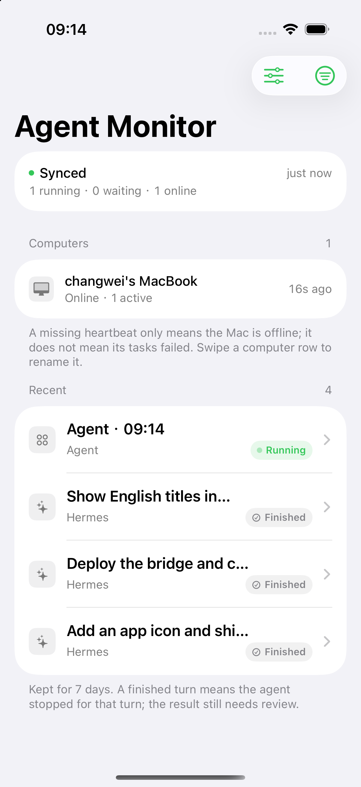
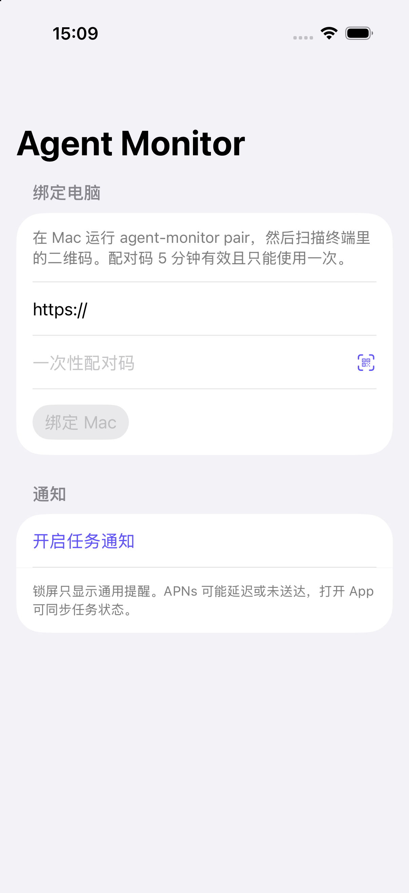
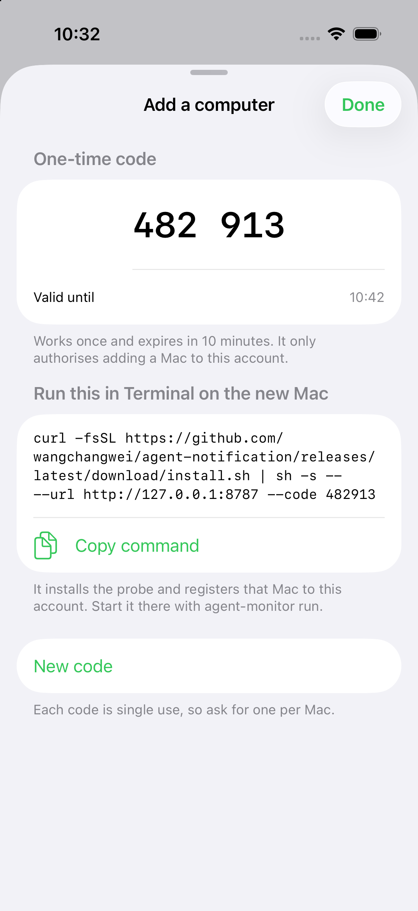
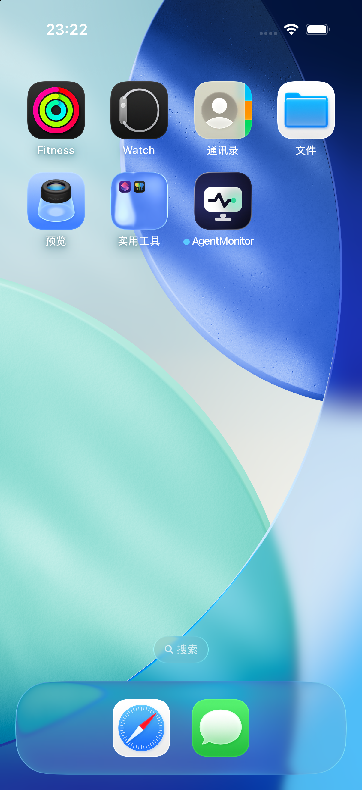
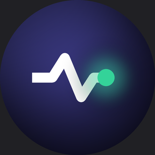

# Agent Monitor

A private, read-only iPhone and Apple Watch companion for [Hermes Agent](https://hermes-agent.nousresearch.com/docs) on macOS. It answers one question away from the desk: **what is my agent doing right now, and did the last run finish?**

The Mac runs a probe that observes Hermes through its plugin hooks, queues sanitized state events locally, and pushes them to a small serverless bridge. The phone and watch read that bridge. Nothing is controllable from the phone: no approving, no sending prompts, no cancelling.



## How it works

```
Hermes (desktop or CLI)
        │  observer hooks: turn, tool, human-input, session end
        ▼
read-only plugin  ──►  SQLite queue (7 days, 4,000 events)  ──►  probe
                                                                   │ heartbeat 30s
                                                                   │ events on change
                                                                   ▼
                                                    bridge (FastAPI on Vercel)
                                                                   │
                                                          Upstash Redis
                                                                   │
                                                    iPhone app (5s poll in foreground)
                                                                   │
                                                          Apple Watch app
```

A phone can be bound to several Macs, and each Mac is listed separately with its own heartbeat. Task state and computer state are deliberately independent: a Mac that stops heartbeating is shown as disconnected, which never implies its tasks failed.

## Components

| Path | What it is |
| --- | --- |
| `agent_monitor/` | macOS probe: CLI, durable SQLite queue, read-only Hermes observer plugin |
| `install.sh` | One-command macOS installer, published as an asset of every release |
| `agent_monitor/bridge.py` | FastAPI API for Vercel Functions plus an Upstash Redis REST adapter |
| `ios/AgentMonitor.xcodeproj` | SwiftUI iPhone app with in-app QR pairing and APNs, embedding the watchOS app |
| `tests/` | API, plugin, queue, CLI and uninstall checks that need no network |
| `docs/release-notes/` | release notes for published versions |

## Screenshots

| Pairing | Dashboard | Add a computer | Home screen | Watch icon |
| --- | --- | --- | --- | --- |
|  |  |  |  |  |

## Local development

```sh
python3 -m venv .venv
. .venv/bin/activate
python -m pip install -e '.[dev,qrcode]'
uvicorn app:app --reload
```

`GET /healthz` works without credentials. Every other API route requires `UPSTASH_REDIS_REST_URL`, `UPSTASH_REDIS_REST_TOKEN` and a strong `MONITOR_BOOTSTRAP_TOKEN`.

## Verify locally

```sh
python3 -m unittest discover -s tests -v
```

The suite runs the API against an in-memory stand-in for the Upstash REST pipeline, plus the observer plugin, queue retention and clearing, CLI URL validation, plugin installation and the full uninstall path. It needs no cloud account, Apple credential or network access.

The iOS state model is checked separately, without a simulator:

```sh
swiftc ios/AgentMonitor/MonitorModels.swift ios/Tests/MonitorStateChecks.swift -o "$TMPDIR/monitor-state-checks"
"$TMPDIR/monitor-state-checks"
```

That covers out-of-order events, task IDs shared by several Macs, incomplete turns, missing durations, heartbeat expiry, and server-clock calibration when the phone clock is ahead or behind.

## Deploy the bridge

1. Create a Vercel Hobby project for personal use and connect this repository.
2. Create an Upstash Redis database and expose its REST URL and token to the project, or add the Upstash integration from the Vercel Marketplace (it injects `KV_REST_API_URL` and `KV_REST_API_TOKEN`, which the bridge reads as well).
3. Generate a strong random `MONITOR_BOOTSTRAP_TOKEN`, add it to Vercel and keep it in your password manager. The Mac setup command prompts for it without echoing the value.
4. Deploy and keep the public HTTPS URL.
5. For APNs, add `APNS_TEAM_ID`, `APNS_KEY_ID`, `APNS_TOPIC` (the signed app's bundle ID) and `APNS_PRIVATE_KEY_B64` (base64-encoded Apple `.p8` key). Development builds use the sandbox host by default; set `APNS_USE_SANDBOX=false` for production-signed builds. Without these variables, event sync still works and push is disabled.

The bridge is stateless. Redis holds device authorization, short-lived pairing codes, the last heartbeat, per-device names and sanitized event history. Ingestion is idempotent: a replayed batch is stored once, only a task's newest state can raise a push, and each event ID claims at most one push so a lost response cannot re-alert. A clear that lands while a Mac is uploading is re-checked after the write, so pre-clear events cannot reappear.

Vercel's Hobby plan is limited to personal, non-commercial use, and Vercel or Upstash may throttle, reject or pause service at free-tier limits; this is not an unlimited-availability promise. Function invocations, database commands, storage and transfer should be measured against your own accounts. Configure provider usage alerts where available: this version has no in-app quota meter and never upgrades a plan automatically. The app polls every five seconds only while foregrounded, and that polling can become the largest Redis command cost.

## Set up each Mac

Open **Agent Monitor → Computers → Add a computer** on the iPhone. The app issues a six-digit code (single use, ten minutes) and shows the exact command; copy it, run it in Terminal on the Mac you want to add:

```sh
curl -fsSL https://github.com/wangchangwei/agent-notification/releases/latest/download/install.sh \
  | sh -s -- --url https://your-project.vercel.app --code 123456
```

Nothing else is needed: the code carries the owner, so no bootstrap token is copied between machines. The installer picks a Python 3.11 or newer, verifies the wheel against the release checksums, installs the probe into `~/Library/Application Support/Agent Monitor/.venv`, links `agent-monitor` into `~/.local/bin` and registers the Mac under the same owner as the phone.

Running the same command again upgrades in place and leaves an existing registration alone; add `--force` to reinstall anyway. `--plugin` also installs and enables the observer plugin, `--brand` sets the agent shown on the phone, and `--help` lists every flag.

The first Mac, before any phone is paired, registers with the bridge's bootstrap token instead:

```sh
curl -fsSL https://github.com/wangchangwei/agent-notification/releases/latest/download/install.sh \
  | sh -s -- --url https://your-project.vercel.app
```

Then install and enable the plugin for the active Hermes profile, if you did not pass `--plugin`, and start the probe:

```sh
agent-monitor install-plugin
hermes plugins enable agent_monitor
agent-monitor pair
agent-monitor run
```

If `~/.local/bin` is not on your `PATH`, the installer says so; either add it or call the binary at `"$HOME/Library/Application Support/Agent Monitor/.venv/bin/agent-monitor"`.

Installing from a downloaded wheel instead of the release script is also supported: create a virtual environment, `pip install './agent_notification-0.1.1-py3-none-any.whl[qrcode]'` into it, and call that environment's `agent-monitor`.

Restart the Hermes desktop app (or run `hermes gateway restart`) once after enabling. Tool events flow immediately, but the turn-level events — turn started, waiting for input, turn finished — are rewired only when the gateway restarts. Commands run through the `hermes` CLI pick the plugin up without a restart.

The terminal QR is short-lived and single-use. The bootstrap token is only needed by `setup`. Device tokens live in the macOS Keychain; the plugin and probe share the SQLite queue under Application Support. To start at login, run `agent-monitor install-service` and then the exact `launchctl bootstrap` command it prints — this is opt-in and nothing is loaded automatically.

Each computer can be renamed from the phone (swipe its row, then the note action); the name is stored with the device record and appears on every phone bound to the same owner. A task row without a title shows the agent brand and the time instead of a placeholder.

## Privacy boundary

The observer never sends prompts, API payloads, tool arguments or results, file contents, absolute paths or conversation text. It transmits opaque per-turn and per-task UUIDs, status transitions, elapsed tool time, a validated tool name, the agent brand, and one short title: the first line of the request with code blocks, links, e-mail addresses, paths and long tokens removed, capped at 24 characters. Set `send_titles` to `false` in the probe's `config.json` to stop sending titles entirely. Push notifications carry only a generic body and a task ID; details require opening the app.

The probe keeps at most 4,000 recent events for seven days locally and retains undelivered events across network failures and restarts.

## Retention, clearing and removal

- The app's clear-history action deletes the server's seven-day event list and sets a watermark, so older queued events cannot reappear when a Mac reconnects.
- `agent-monitor clear-local-history` erases one Mac's local queue.
- `agent-monitor uninstall` removes the probe package, the active-profile plugin, app data, the Keychain item and the LaunchAgent, and revokes the Mac's cloud credential when reachable. If the Mac is offline, revoke the device from the phone once it reconnects.
- Revoking a device from the phone deletes its cloud history immediately; the Mac's credential stops working at once.

## Build the iOS app

Open `ios/AgentMonitor.xcodeproj`, choose an iOS Simulator destination, and build `AgentMonitor`. Debug and simulator builds use the development APNs entitlement; Release uses the production one. For a real iPhone, set your development team and bundle identifier, enable Push Notifications for the matching App ID, and keep the bridge's `APNS_TOPIC` and `APNS_USE_SANDBOX` in step with how the app was signed.

From the command line, build by scheme and destination so each target resolves its own SDK:

```sh
xcodebuild -project ios/AgentMonitor.xcodeproj -scheme AgentMonitor \
  -configuration Debug -destination 'generic/platform=iOS' CODE_SIGNING_ALLOWED=NO build
```

Do not add `-sdk` to that command: it applies to every target, so the embedded watch app is compiled against the iOS SDK and fails in the watch asset catalog and `WCSessionDelegate`. Use `-sdk watchsimulator` only for `-target AgentMonitorWatch` on its own.

The app keeps its access token in the Keychain. Pairing happens through the in-app camera scanner or by typing the one-time code. When a task moves from running or waiting to finished while the app is open, it plays one system sound and haptic; that is silent in the background and can be turned off in the app's settings.

## Build the watch app

`AgentMonitorWatch` is a single-target watchOS app embedded in the phone app's `Watch` folder. `ios/generate_project.py` emits both targets, so regenerate and rebuild after changing build settings.

```sh
xcodebuild -project ios/AgentMonitor.xcodeproj -target AgentMonitorWatch -sdk watchsimulator \
  -configuration Debug CONFIGURATION_BUILD_DIR="$PWD/.build/watch" CODE_SIGNING_ALLOWED=NO build
xcrun simctl install <watch-udid> .build/watch/AgentMonitorWatch.app
```

The watch mirrors the phone read-only: what is running, what is waiting, and how each task ended. It keeps its own copy of the bridge URL and device token, handed over once through WatchConnectivity whenever the phone app comes forward (`PhoneWatchLink` → `WatchLink`); it never reads the phone's Keychain, and unpairing clears the watch copy. It polls every ten seconds while visible. There is no complication and no watch-side notification yet, so background alerts still come from the phone's APNs.

## Release notes

Release notes are written in English and kept under `docs/release-notes/`; the same file is used as the body of the matching GitHub release. See `docs/release-notes/v0.1.1.md`.

## Boundaries

This repository does not create Vercel or Upstash resources, deploy to those accounts, install or enable the Hermes plugin, or register a LaunchAgent on your behalf. APNs requires your own Apple developer team and private key. The app never controls agent tasks. Vercel and Upstash limits and policies change; verify current account terms and usage before relying on the deployment.

## License

Released under the [MIT License](LICENSE).